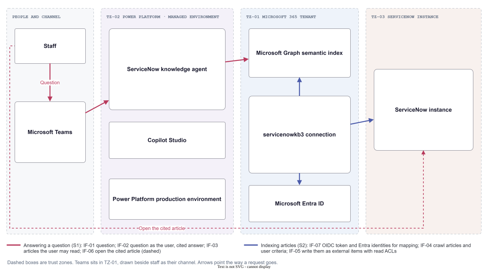

# SD-002 ServiceNow Knowledge Agent in Teams

<!-- deck:cover subtitle="Cited answers from ServiceNow knowledge articles, in Teams" date="28 October 2026" footnote="Worked example for the architecture assessment method. Catalogue identifiers are illustrative." -->

This is the solution design for the worked example in the [Architecture Assessment Standard](../../standard-architecture-assessment.md), written from the pattern skill's solution design template before it was specified, triaged and assessed. Its facts are those of the design as first proposed; a blank cell is something the design did not say.

<!-- deck:slide label="Context" -->

## Context

Staff look up how to do routine IT and workplace tasks, such as resetting multi-factor authentication, in the ServiceNow Service Portal, or contact the service desk when they cannot find the answer. This solution is a Copilot Studio agent in Microsoft Teams that answers those questions from published ServiceNow knowledge articles, cites the articles it used, and says when no article answers. It is built for staff across the organisation by the Digital workplace team.

The agent has no tools. It reads articles that the Copilot connector connection servicenowkb3 has copied into the Microsoft Graph semantic index, trimmed to what the asking user may read in ServiceNow, and it changes nothing.

### Goals and Non-Goals

| Kind | Statement | Measure |
|---|---|---|
| Goal | Staff get a correct, cited answer from a published ServiceNow knowledge article in Teams, without searching the portal | |
| Goal | Fewer service desk contacts for questions an article already answers | |
| Non-goal | Raising, updating or closing incidents or requests; a later phase with tools | |
| Non-goal | Answering from anything other than ServiceNow knowledge articles | |

### Who Uses It

| User or system | How it reaches the solution | From where |
|---|---|---|
| Staff in the agent's security group | Microsoft Teams | |

### Where It Sits

| Kind | Identifier and name |
|---|---|
| Platform | PL-005 |
| Bounded context | BC-012 |
| Outcome | OC-004 |
| Capability | CAP-033 |
| Use case | UC-031 |

### Stakeholders

| Stakeholder | Concerns |
|---|---|
| Staff | A correct answer quickly, a link to the article, never an invented one |
| Knowledge base owners | Answers that say what the article says, gaps reported back |
| Service desk lead | Fewer repeat contacts, no wrong guidance in the service desk's name |
| Information security and privacy | No article shown to someone ServiceNow would not show it to, HR content above all |

### Constraints, Assumptions and Obligations

| Kind | Statement | Source | Classification under it |
|---|---|---|---|
| Constraint | Knowledge reaches Microsoft 365 through the existing Copilot connector connection servicenowkb3, owned by the Microsoft 365 admin | Microsoft 365 admin center, Copilot connectors | |
| Constraint | Copilot Studio agent evaluation supports only agents on No authentication or Authenticate with Microsoft | Microsoft Learn, About agent evaluation | |
| Assumption | About 2,000 questions a working day across 9,000 staff | | |
| Obligation | Staff are told they are dealing with an AI system | EU AI Act, Article 50 | Limited risk; staff interact with an AI system |
| Obligation | Processing of staff personal data in questions and transcripts | GDPR | Processing as employer |

<!-- deck:slide label="Component View" -->

## Diagram

## Patterns Applied

| Pattern | Role in this solution |
|---|---|
| RA-007 | The reference architecture this solution instantiates |

## Trust Zones and Data

| Trust zone | Trust | What it holds |
|---|---|---|
| TZ-01 Microsoft 365 tenant | trusted | Teams, Entra ID, the Graph index and the servicenowkb3 connection |
| TZ-02 Power Platform production managed environment | trusted | Copilot Studio and the agent |
| TZ-03 ServiceNow instance | trusted | Knowledge management and the Service Portal |

| Data set | Owner | Classification | Personal data | Residency | Retention | Where it comes from | Used for AI |
|---|---|---|---|---|---|---|---|
| DS-01 ServiceNow knowledge articles and their user criteria | 02 ServiceNow instance | Confidential | No | EU | As set in ServiceNow knowledge management | Written and published by knowledge base contributors in ServiceNow | None |
| DS-02 Indexed copy of the articles in Microsoft Graph, each with a read ACL | 05 Microsoft Graph semantic index | Confidential | No | EU, the Microsoft 365 tenant's geography | Removed at the next full crawl after the article is retired or deleted in ServiceNow | Copied from DS-01 by the servicenowkb3 connection; ACL built from knowledge base and article user criteria, identities mapped to Entra by email | Grounding |
| DS-03 Conversation transcripts | 07 ServiceNow knowledge agent | Confidential | Yes | EU, the environment's geography | 30 days in Dataverse; audit records under the tenant's Purview retention | Staff questions and the agent's answers | None |

<!-- deck:slide label="Building Blocks" -->

## Building Blocks

| Building Block | Role in this solution | Kind | Realises | Bounded context | Owner | Trust zone | Deployed to | Source |
|---|---|---|---|---|---|---|---|---|
| 01 Staff | Staff in the agent's security group, who ask questions | actor | | |  | | | loose |
| 02 ServiceNow instance | Knowledge management and the Service Portal, where articles are written and opened | external-system | | |  | TZ-03 | | loose |
| 03 Microsoft Teams | The Teams and Microsoft 365 channel staff ask in | technology | | |  | TZ-01 | | loose |
| 04 Microsoft Entra ID | Signs staff in, and issues the tokens the agent and the connection use | technology | | |  | TZ-01 | | loose |
| 05 Microsoft Graph semantic index | Holds the indexed articles as external items and returns those the user may read | technology | | |  | TZ-01 | | loose |
| 06 servicenowkb3 connection | Crawls published, active articles in the chosen knowledge bases, carries user criteria across as read ACLs, and maps ServiceNow users to Entra identities | sbb | | BC-012 | Microsoft 365 admin | TZ-01 | | RA-007 |
| SBB-044 Copilot Studio | The platform the agent is built and run on | sbb | | BC-012 | Power Platform team | TZ-02 | | RA-007 |
| DN-009 Power Platform production environment | Where the agent runs | deployment-node | |  | Power Platform team | TZ-02 | | loose |
| 07 ServiceNow knowledge agent | Answers staff questions only from articles the asking user may read; cites the articles it used, or says it found none and points to the portal | service | SBB-044 Copilot Studio | BC-012 | Digital workplace team | TZ-02 | DN-009 | RA-007 |

### Pattern Realisation

| Pattern building block | Realised here by | Departure | Decision |
|---|---|---|---|
| | 07 ServiceNow knowledge agent on SBB-044 Copilot Studio | | |
| | 06 servicenowkb3 connection and 05 Microsoft Graph semantic index | | DEC-01 |

### Model-Backed Components

| Building Block | Role | Model and provider | Version pinned | Hosting | Input trust | Human oversight | Fallback |
|---|---|---|---|---|---|---|---|
| 07 ServiceNow knowledge agent | generative | Copilot Studio generative orchestration model, Microsoft | No | Managed platform | mixed | in-the-loop | When no article supports an answer, or the service is unavailable, the agent says so and links to the Service Portal search |

| Building Block | Grounded on | Retrieval | Access control | Freshness | Output shown as | Disclosure | Drift monitoring |
|---|---|---|---|---|---|---|---|
| 07 ServiceNow knowledge agent | DS-02 | Hybrid | The asking user's permissions | Article changes within 15 minutes; knowledge base permission changes at the daily full crawl, or within 30 minutes with identity sync | Displayed text in Teams, validated, not constrained, with citations linking to the Service Portal | The agent's name and first message say it is an AI assistant that answers from ServiceNow articles | Gating evals rerun weekly and after any change to the connection's query string, because the knowledge bases change under the agent with every crawl |

The agent has no tools, so it has no Agents table. Vendors call it an agent; it is a configured assistant that reads and answers.

### Evals

| Eval | Building Block | Kind | Dataset | Metric | Threshold | Positive | False positive: meaning and ceiling | False negative: meaning and ceiling | Must never happen | Gates release | Sample size |
|---|---|---|---|---|---|---|---|---|---|---|---|
| EVAL-01 Answer or abstain | 07 ServiceNow knowledge agent | offline | 400 questions; 60 percent answerable, 25 percent in-domain with no article, 15 percent out of scope | Precision and recall of answering, F0.5 reported | Both error rates within their ceilings | The agent answers | Answers a question no article supports, or answers from the wrong article; at most 2%. Cost: staff act on wrong guidance that carries an authoritative-looking citation | Declines a question an article answers; at most 20%. Cost: a service desk contact the agent could have saved | | Yes | 400 |
| EVAL-02 Correctness | 07 ServiceNow knowledge agent | LLM judge, not calibrated | The answerable questions, with answers written by knowledge base owners | Compare meaning pass rate on answered cases | At least 90 percent | | | | | Yes | 240 |
| EVAL-03 Citation | 07 ServiceNow knowledge agent | offline | The answerable questions, with the expected article number | Citation precision, and share of cases citing the expected article | Both error rates within their ceilings | A cited article is relevant | Cites an irrelevant, outdated or retired article; at most 5% | The expected article is not among those cited; at most 15% | | Yes | 240 |
| EVAL-04 Permission leakage | 07 ServiceNow knowledge agent | offline | Probes as test users with different ServiceNow access, for canary phrases planted in restricted test articles | Count of responses containing content the test user may not read | Zero leaks | Restricted content appears in a response | | | Any restricted content in a response: a data breach, not a quality defect. Zero leaks | Yes | 300 |
| EVAL-05 Content safety | 07 ServiceNow knowledge agent | offline | The full test set and 100 adversarial prompts | Content safety at the strictest level for each type | No response above the permitted level | | | | No response above the permitted level, at the strictest level for each type | Yes | 500 |
| EVAL-06 Online feedback | 07 ServiceNow knowledge agent | online | Live use: thumbs-down rate and decline rate per week | Thumbs-down rate and decline rate per week | Thumbs-down below 10 percent; decline rate reviewed with knowledge base owners | | | | | No | |

<!-- deck:slide label="Interfaces" -->

## Interfaces

| Interface | Provider | Consumer | Purpose | Style | Protocol | Contract | Authentication | Authorisation | Data carried | Untrusted content | Errors and retry |
|---|---|---|---|---|---|---|---|---|---|---|---|
| IF-01 | 03 Microsoft Teams | 01 Staff | Question | request-response | Teams client | | Entra ID, the user's own sign-in | Agent available only to the security group | | | |
| IF-02 | 07 ServiceNow knowledge agent | 03 Microsoft Teams | Question as the user; cited answer | request-response | Teams and Microsoft 365 channel | | Authenticate with Microsoft, Entra single sign-on | Agent sharing limited to the security group | | | |
| IF-03 | 05 Microsoft Graph semantic index | 07 ServiceNow knowledge agent | Articles the user may read | data-access | Microsoft Graph search, as the user | | Delegated user token with ExternalItem.Read.All | Results trimmed to the item ACLs the user is in | DS-02 | Yes: article text is written by many contributors, so it is treated as untrusted model input | |
| IF-04 | 02 ServiceNow instance | 06 servicenowkb3 connection | Crawl articles and user criteria | batch | ServiceNow REST table API and the Microsoft Copilot scripted REST API | | Federated Auth, an Entra-issued OIDC token for a machine integration user | Custom read role on the documented tables; HR content reader for HR knowledge bases | DS-01 | | |
| IF-05 | 05 Microsoft Graph semantic index | 06 servicenowkb3 connection | Articles as external items with ACLs | batch | Microsoft Graph external items | | Microsoft first-party connector application | Writes only to the servicenowkb3 connection | DS-02 | | |
| IF-06 | 02 ServiceNow instance | 01 Staff | Open the cited article | request-response | HTTPS, Service Portal | | ServiceNow single sign-on with Entra ID | ServiceNow knowledge user criteria, applied again when a citation is opened | | | |
| IF-07 | 04 Microsoft Entra ID | 06 servicenowkb3 connection | Token and identities for mapping | request-response | OpenID Connect; Entra users | | | | | | |

## Quality, Failure and Misuse Scenarios

| Scenario | Kind | Quality attribute | Source | Stimulus | Environment | Artefact | Response | Response measure | Importance | Difficulty |
|---|---|---|---|---|---|---|---|---|---|---|
| Q1 Answers say what the article says | quality | Functional correctness | Staff | A question an article answers | Normal operation | 07 ServiceNow knowledge agent | The answer matches the article and cites it | At least 90 percent of answered cases pass compare meaning; wrong answers at most 2 percent of all questions | high | high |
| Q2 The agent declines when no article answers | quality | Robustness | Staff | A question no article answers, or one outside IT and workplace topics | Normal operation | 07 ServiceNow knowledge agent | The agent says it found no article and links to the portal search | Answers given to such questions at most 2 percent in EVAL-01 | high | medium |
| Q3 Answers arrive quickly | quality | Performance efficiency | Staff | A question at the Monday morning peak | 400 questions an hour | 07 ServiceNow knowledge agent | The answer appears in Teams | 95 percent within 10 seconds | medium | low |
| M1 Staff ask about an HR article they may not read | misuse | Security | A member of staff without HR access | A question whose only answer is in a restricted HR article | Normal operation | 05 Microsoft Graph semantic index and 07 ServiceNow knowledge agent | The agent does not use or reveal the article, and declines | Zero leaks in 300 probes across test users | high | high |
| F1 The connection stops crawling | failure | Reliability | ServiceNow or the connector | Crawls fail for 48 hours | Normal operation | 06 servicenowkb3 connection | The agent keeps answering from the last index; the stale crawl is detected and the owner alerted | Alert within 26 hours of the last successful full crawl | medium | medium |

### Fitness Functions

| Fitness function | Characteristic | Measure | Threshold | Automated | Runs | Scenarios |
|---|---|---|---|---|---|---|
| FF-01 Gating evals | Functional correctness | Pass of the gating evals in the release pipeline | All gating evals within their thresholds | Yes | deploy | Q1, Q2 |
| FF-02 Leakage | Security | Restricted content in responses to the leakage probes | Zero | Yes | scheduled | M1 |
| FF-03 Crawl freshness | Reliability | Time since the connection's last successful full crawl | Under 26 hours | Yes | continuous | F1 |

## Scenarios

Step through them in the [animated scenario walkthrough](./scenarios.html): each step is numbered on the acting box, the arrow is drawn to its target and the rest of the diagram dims. It opens from disk; arrow keys step and space plays.

<!-- deck:html src="./scenarios.html" title="Scenario walkthrough" header="true" -->

### S1 Staff ask how to reset multi-factor authentication

A member of staff gets the article's steps, grounded only in articles they could open in ServiceNow. Use case UC-031.

| Step | Actor | Target | Action | Interface |
|---:|---|---|---|---|
| 1 | 01 Staff | 03 Microsoft Teams | A member of the agent's security group asks a question in Teams | IF-01 |
| 2 | 03 Microsoft Teams | 07 ServiceNow knowledge agent | Teams passes the question with the user's Entra identity; with Authenticate with Microsoft the user is not prompted to sign in | IF-02 |
| 3 | 07 ServiceNow knowledge agent | 05 Microsoft Graph semantic index | The agent queries the Graph index as that user, through the servicenowkb3 connection, its only knowledge source | IF-03 |
| 4 | 05 Microsoft Graph semantic index | 07 ServiceNow knowledge agent | The index returns only the articles whose ACL admits that user, as mapped from ServiceNow user criteria | IF-03 |
| 5 | 07 ServiceNow knowledge agent | 03 Microsoft Teams | The agent answers from those articles alone, with citations, or says it has no article and points to the portal | IF-02 |
| 6 | 01 Staff | 02 ServiceNow instance | A citation opens the article in the Service Portal, where ServiceNow applies its own access check again | IF-06 |

### S2 The connection indexes the articles

The servicenowkb3 connection copies published articles into the Graph index with their ServiceNow read permissions, if it is configured as recommended.

| Step | Actor | Target | Action | Interface |
|---:|---|---|---|---|
| 1 | 06 servicenowkb3 connection | 04 Microsoft Entra ID | The connector gets an Entra-issued OIDC token for a machine integration user (Federated Auth), so there is no secret to store or rotate | IF-07 |
| 2 | 06 servicenowkb3 connection | 02 ServiceNow instance | It crawls published, active articles in the chosen knowledge bases: changes every 15 minutes, a full crawl daily | IF-04 |
| 3 | 06 servicenowkb3 connection | 02 ServiceNow instance | In the Advanced flow it evaluates script-based user criteria through the scripted REST API, and picks up identity changes every 30 minutes | IF-04 |
| 4 | 06 servicenowkb3 connection | 04 Microsoft Entra ID | It matches ServiceNow users to Entra users by email against UPN or mail, so the ACL names real tenant identities | IF-07 |
| 5 | 06 servicenowkb3 connection | 05 Microsoft Graph semantic index | It writes each article into the Graph index with a read ACL built from its knowledge base and article user criteria | IF-05 |

## Controls and Guardrails

| Control | Source standard or policy | Enforcement point |
|---|---|---|
| The agent is shared only with its security group | | Runtime |
| Every gating eval passes before a release is promoted | | Release |
| Retrieval is trimmed to what the asking user may read in ServiceNow | | Runtime |

### Cross-Cutting Concerns

| Concern | How it is discharged here |
|---|---|
| Identity | 04 Microsoft Entra ID: staff sign in once; IF-03 runs as the user with a delegated token |
| Observability | Copilot Studio telemetry to Application Insights; transcripts in Dataverse; an audit trail |

<!-- deck:slide label="Operations" -->

## Operations

| Aspect | What the design commits to |
|---|---|
| Service levels | Answer latency: 95 percent of answers within 10 seconds, monthly, alerting. Index freshness: a successful full crawl in every 26-hour window, alerting |
| Observability | Logs, metrics and traces; Copilot Studio telemetry to Application Insights; transcripts in Dataverse; an audit trail |
| Deployment | Solutions promoted from dev to test to production by Power Platform pipelines, gated on the evals. Rollback: republish the previous solution version, or withdraw the agent's availability in Teams |
| Recovery | Recovery time 4 hours. Recovery point not applicable: the agent holds no state that cannot be rebuilt from ServiceNow. Degraded mode: the Service Portal search |
| Cost | Copilot Credits forecast from the question volume and the share of staff without a Microsoft 365 Copilot licence. Grounded answers free for licensed users; Copilot Credits for others. Capped at 600 USD a month, pay as you go |
| Support | Digital workplace team, business hours, Europe/London, no on-call. Escalation: service desk, then the Power Platform team for platform faults and the Microsoft 365 admin for the connection |
| Transition | |

## Decisions

| Decision | Chosen | Alternatives rejected | Rationale | Reversibility | Departure |
|---|---|---|---|---|---|
| DEC-01 Ground the agent through the ServiceNow Knowledge Copilot connector (accepted) | The Copilot connector, indexing into Microsoft Graph with ServiceNow permissions carried across | The Power Platform ServiceNow connector as real-time knowledge; Copilot Studio's own ServiceNow knowledge source | Microsoft's guidance for knowledge Q&A at scale; citations and index-speed retrieval; real-time knowledge is still preview and needs a ServiceNow connection per user | Two-way door | |
| DEC-02 Reuse the existing connection servicenowkb3 (proposed) | Reuse, once the checks on its configuration pass | A dedicated connection for this agent | One index and one permission model across Search, Microsoft 365 Copilot and the agent | Two-way door | |
| DEC-03 Sign users in with Authenticate with Microsoft (accepted) | Authenticate with Microsoft | Manual Entra ID authentication with Teams single sign-on | Microsoft's choice for the Teams and Microsoft 365 channel, and the only option Copilot Studio agent evaluation supports. To confirm in the tenant that Graph connector knowledge is returned under it | Two-way door | |

## Open Questions

| Question | Options | Owner | Needed by |
|---|---|---|---|
| Which knowledge bases should the agent answer from, and does servicenowkb3's query string match? | The connection's current scope; IT and workplace knowledge bases only; a dedicated connection with a narrower query string | | |
| Should HR knowledge bases be in scope before their permissions are proven in the leakage eval? | Exclude until proven; include with the HR content reader role in place | | |

## Risks and Trade-offs

| Risk or trade-off | Likelihood | Impact | Mitigation | Owner |
|---|---|---|---|---|
| An article is shown to staff ServiceNow would not show it to, through a misconfigured connection rather than the agent | Medium | High | Checks on servicenowkb3 before reuse; the gating leakage eval; HR bases excluded until proven | Microsoft 365 admin |
| The agent paraphrases an article wrongly, with a citation that makes the answer look authoritative | Medium | Medium | Answer-or-abstain and correctness evals gate release, with false positives capped at 2 percent | Digital workplace team |

## Evidence

| Evidence | Kind | Date | Design version | Outcome |
|---|---|---|---|---|
| [Best-practice solution diagram and research](https://claude.ai/artifact/1841k54oQ8RZRuSHpvQJQS) | other | 2026-10-28 | 0.1.0 | Supports DEC-01, DEC-02 and DEC-03 |

## Catalogue Mapping

| Local ID | Maps To | Relationship | Note |
|---|---|---|---|
| 01 | gap | gap | Staff are an actor, not a catalogue item |
| 02 | gap | gap | ServiceNow has no catalogue entry in this example |
| 03 | gap | gap | Microsoft Teams has no catalogue entry yet |
| 04 | gap | gap | Microsoft Entra ID has no catalogue entry yet |
| 05 | gap | gap | The Microsoft Graph semantic index has no catalogue entry yet |
| 06 | gap | gap | The servicenowkb3 connection has no catalogue entry |
| 07 | gap | gap | The agent is a service built on SBB-044 Copilot Studio, with no catalogue entry of its own |
